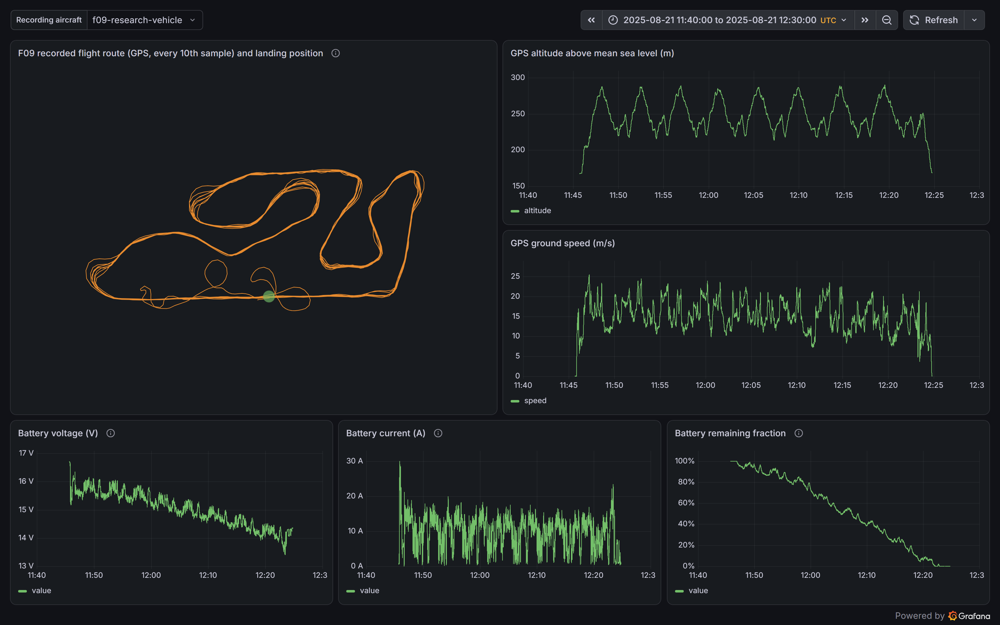
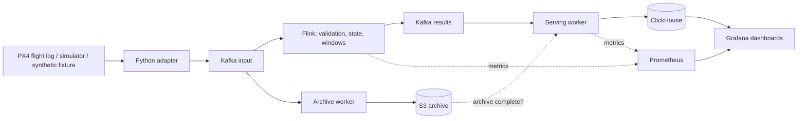
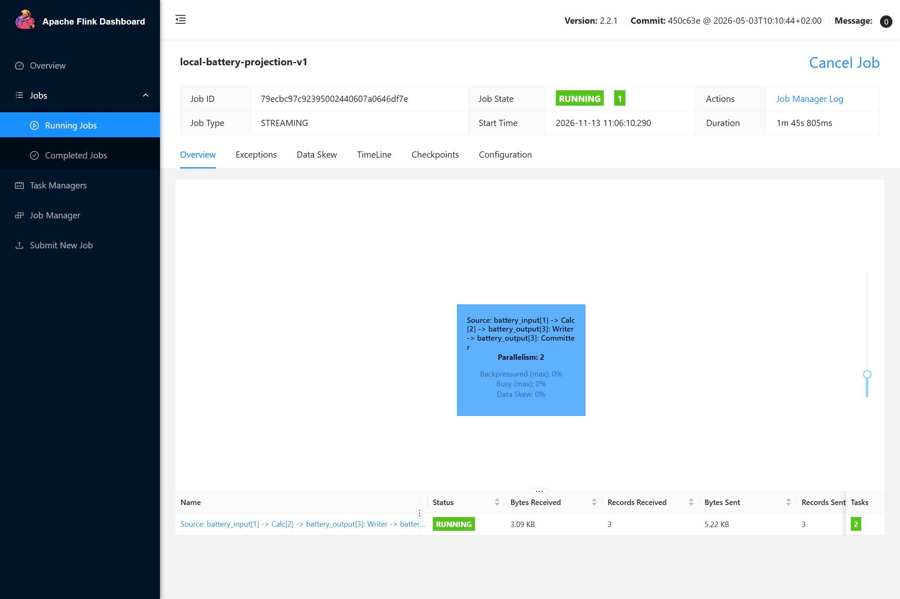
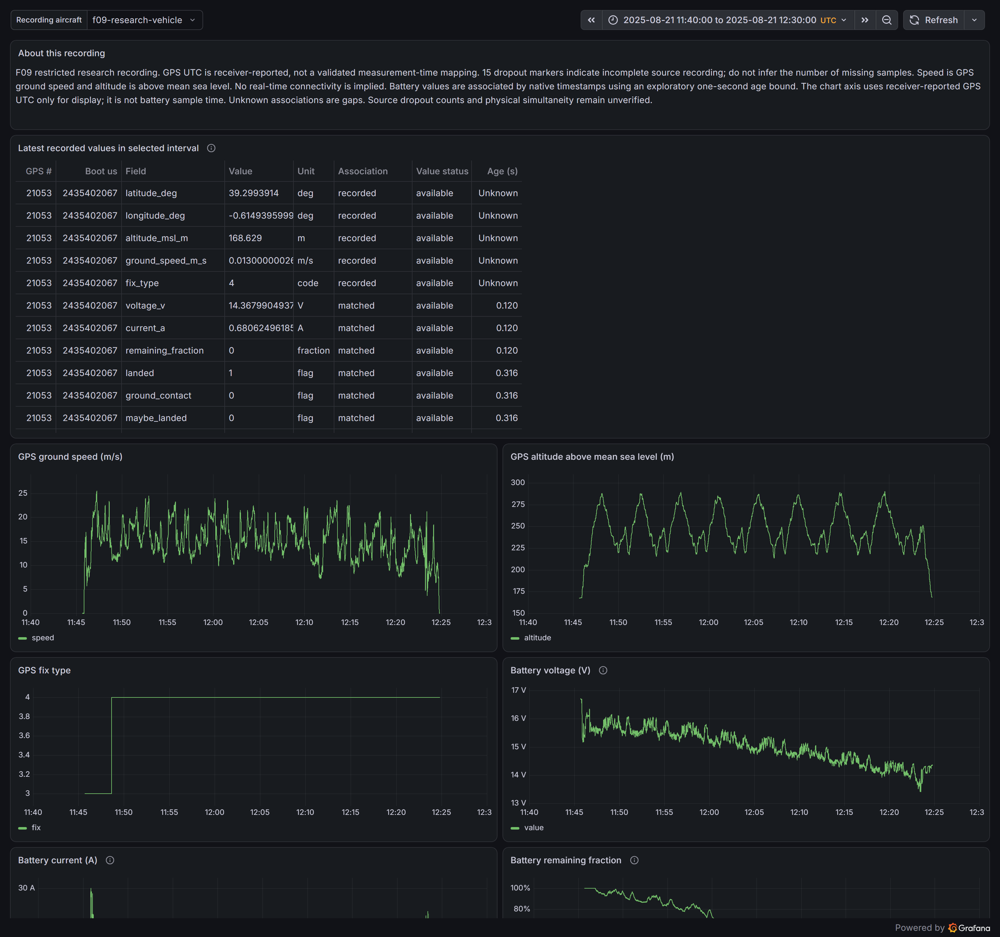
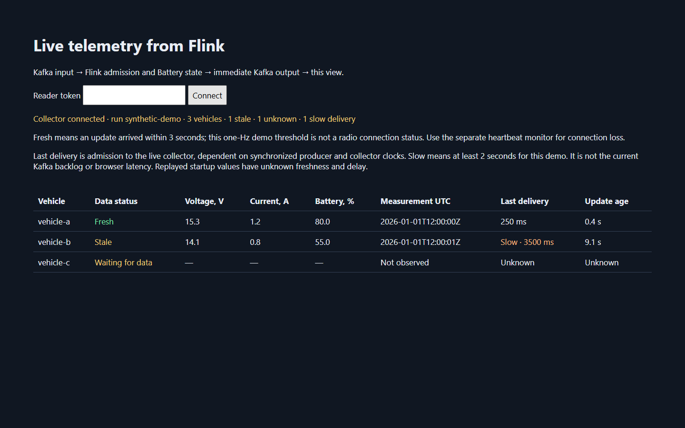
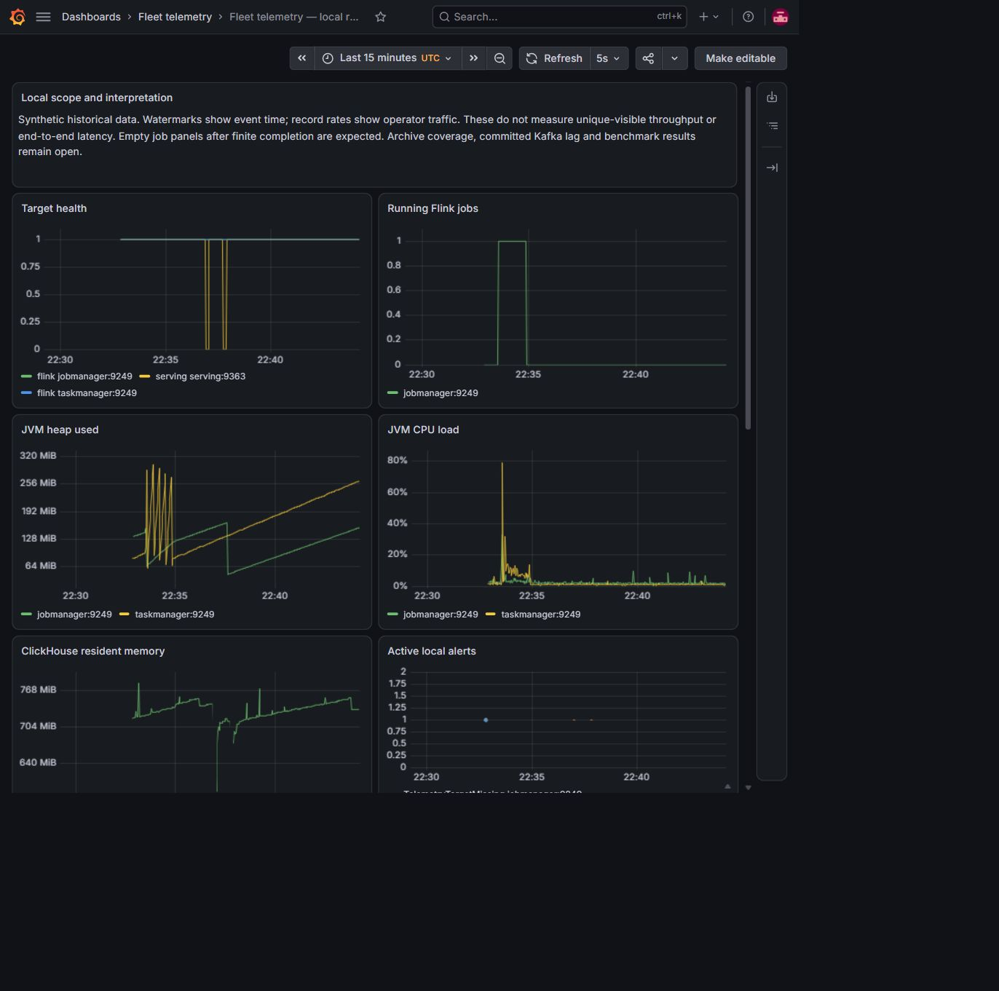

# Fleet Telemetry

[](https://github.com/IvanHaiko/fleet-telemetry/actions/workflows/m1.yml)

A streaming data platform for drone flight telemetry. It replays PX4 flight logs
and simulator streams through **Kafka → Flink → S3 archive → ClickHouse →
Grafana**, and keeps every result traceable to the original recording.

Every event carries its original measurement ID, units, source clock and
delivery history. That makes it possible to explain any value on a dashboard, to
tell a missing reading from a zero, and to prove that a retry did not change the
answer. The platform only observes telemetry; it never controls a vehicle.



*A real 40-minute fixed-wing research flight, served from ClickHouse: GPS route,
altitude with eight loiter climbs, ground speed and the battery draining from 100%
to empty.*



## Highlights

- **100 vehicles × 5 Hz, every event accounted for.** A two-computer run
  delivered 360,100 synthetic events in 12 minutes (500 events/s). Kafka
  acknowledgements, archived deliveries and ClickHouse rows matched one to one
  by ID and content hash. [Report](docs/case-studies/m6-load-500-8g.md)
- **A real flight through the whole path.** 60 seconds of a public PX4
  fixed-wing research flight (CC BY 4.0): 1,017 events became 538 deduplicated
  GPS-centred facts in ClickHouse. When archiving was paused, serving stopped at
  415 facts and resumed to 538 once the archive caught up.
  [ADR-0050](docs/adr/0050-integrated-f09-runtime.md)
- **An upstream client bug, reproduced and tested.** On Windows,
  `confluent-kafka-python` truncates 64-bit Kafka UUID halves to 32 bits. The
  repository contains a reproduction, a native regression test prepared for the
  related upstream pull request, and a narrow fallback fix.
  [Package](contributions/confluent-kafka-uuid-int64/README.md)
- **Engineering hygiene.** 660+ tests, strict mypy, CI passing on Windows and Linux,
  pinned images and lockfiles, and 51 [architecture decision records](docs/adr/).

## Quickstart: Kafka and Flink on one machine

You need Docker with Compose (at least 6 GiB of memory and 4 CPUs) and Python
3.13. The helper uses only the standard library, so there is nothing to install.

```sh
python scripts/local.py start   # one Kafka broker, Flink JobManager + TaskManager
python scripts/local.py demo    # convert a fixture, run the Flink SQL job, read back
```

`demo` publishes three synthetic battery measurements, runs them through a
Flink SQL job and reads the results back from Kafka. It checks that IDs and
measurement times are unchanged, missing values stay missing and power is
calculated. Success prints `"status": "verified", "measurements": 3`.
The [Flink UI](http://127.0.0.1:8081) shows the running job:



```sh
python scripts/local.py status
python scripts/local.py stop    # keeps Kafka and checkpoint volumes
```

The quickstart covers the streaming core only. The archive, ClickHouse and
Grafana layers run from separate profiles in [`compose/`](compose/). See the
[local guide](docs/local-development.md) for ports, resources and limits.

## Without Docker: offline conversion

This turns the checked-in synthetic fixture into canonical events, verifies the
run and reads it back. It needs Python 3.13 and [uv](https://docs.astral.sh/uv/)
0.11.19.

```sh
uv sync --frozen
uv run --no-sync python -c "from pathlib import Path; Path('.local-discovery/readme-demo').mkdir(parents=True, exist_ok=True)"
uv run --no-sync python -S telemetry_convert.py --job tests/fixtures/synthetic-conversion-job.json --output .local-discovery/readme-demo/demo-synthetic-001
uv run --no-sync python -S telemetry_convert.py --job tests/fixtures/synthetic-conversion-job.json --verify .local-discovery/readme-demo/demo-synthetic-001
uv run --no-sync python -S telemetry_reader.py .local-discovery/readme-demo/demo-synthetic-001/events.jsonl
```

Expected result: 3 accepted measurements, 1 rejection with an explicit reason,
and a checksummed run manifest. Output directories are never overwritten, so use
a new directory when you repeat the example. To parse real PX4 ULog files, add
the optional reader with `uv sync --frozen --extra ulog`; the
[conversion guide](docs/guides/bounded-conversion.md) explains jobs, rejection
reasons and input limits.

## Screenshots



*Recording detail for the same flight. Every value carries its unit, how it was
associated with GPS time (`recorded`, `matched`) and its age; unknown values stay
`Unknown` instead of turning into zero.*

<details>
<summary>Live view and system monitoring</summary>



*Stale and missing readings stay visible instead of looking like healthy current
values. Synthetic data.*



*System monitoring from a local run.*

</details>

[Capture details](docs/assets/README.md)

## Design choices

- **Originals are kept.** The raw recording and the exact Kafka records are
  archived independently of Flink, so any result can be rebuilt and checked.
- **Missing is not zero.** Unknown, stale and rejected values are explicit
  states with reasons, not defaults.
- **Two clocks.** Measurement time and delivery time are separate fields; a
  replay never pretends to be live.
- **Serving waits for the archive.** ClickHouse only receives facts whose inputs
  are already safely archived.
- **At-least-once, deduplicated at the edge.** Kafka output may repeat; the
  serving layer reconciles content and deduplicates by logical ID.

The full stack is shown in the [architecture diagram](docs/mvp-target.png) and
described in [architecture](docs/architecture.md) and
[data contracts](docs/data-contracts.md).

## Status

This is a working local research prototype, not a production system.

| Area | Demonstrated | Still open |
| --- | --- | --- |
| One-machine Kafka/Flink starter | Synthetic runs reconcile end to end | Checkpoint restore in the starter |
| Synthetic conversion | Deterministic events, identity and manifest checks | Arbitrary devices and firmware |
| Archive, ClickHouse, Grafana | Replay, deduplication and selected failure/recovery checks on synthetic data | Production recovery; hosted CI for the broker lane |
| Real flight (F09) | 60-second interval through the full path | Full flight; checkpoint restore |
| PX4 simulator (SITL) | Live position from source to SQL; a continuous session | Physical vehicles and radio links |

F09 is a public fixed-wing research flight log; SITL is PX4's
software-in-the-loop simulator. Work is organised in milestones M1 (data
sources) to M6 (observability and benchmarks); the [roadmap](docs/roadmap.md)
describes each one and what remains, including an optional AWS deployment with
Terraform.

## Development

```sh
uv run --no-sync python scripts/check-m1.py --profile synthetic
```

The check runner verifies the lockfile and runs Ruff, strict mypy, the test
suite and a fresh conversion. Use `--profile ulog` to include the ULog reader.
The [contributor guide](CONTRIBUTING.md) covers focused checks and the separate
Flink and broker test suites.

## Repository layout

| Path | Contents |
| --- | --- |
| `telemetry/` | Event contracts, validation, processing, archive and serving logic |
| Root `*.py` | Public API and command-line entry points for conversion and checks |
| `runtime/` | Kafka, Flink, S3, ClickHouse and Grafana configuration and workers |
| `compose.yaml` | The one-machine Kafka/Flink starter |
| `compose/` | Additional profiles: archive, serving, monitoring, live capture |
| `scripts/` | Scenario runners and operational checks |
| `tests/` | Unit and regression tests with small synthetic fixtures |
| `docs/` | Architecture, guides, reference, reports and ADRs ([index](docs/README.md)) |
| `contributions/` | The upstream Kafka client fix and its license |

## License and data

Code and documentation are released under the [MIT License](LICENSE).
Third-party material keeps its own license, including the
[Kafka client contribution](contributions/confluent-kafka-uuid-int64/README.md).
Flight recordings are not included in this repository; screenshots contain
synthetic telemetry and local service metrics only.
