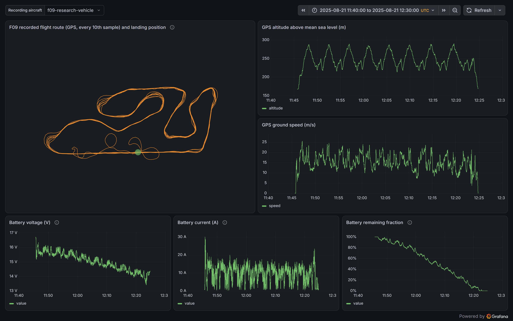
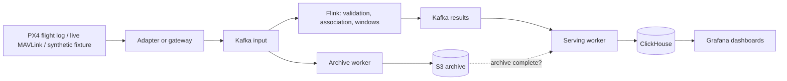

# Fleet Telemetry

[](https://github.com/IvanHaiko/fleet-telemetry/actions/workflows/m1.yml)

A streaming data platform for drone flight telemetry. It takes PX4 flight logs
and live MAVLink streams through **Kafka → Flink → S3 archive → ClickHouse →
Grafana**, and keeps every value on a dashboard traceable to the original
recording.

Every event carries its measurement ID, units, source clock and delivery
history. That makes it possible to explain any value, to tell a missing
reading from a zero, and to prove that a retry or a restart did not change the
answer. The platform only observes telemetry; it never controls a vehicle.



*A real 40-minute fixed-wing research flight, served from ClickHouse: GPS route,
altitude, ground speed and the battery draining from 100% to empty.*

## How it works



- **Originals are kept.** The raw recording or capture and the exact Kafka
  records are archived independently of Flink, so any result can be rebuilt
  from the archive alone and compared.
- **Missing is not zero.** Unknown, stale and rejected values are explicit
  states with reasons, not defaults.
- **Two clocks.** Measurement time and delivery time are separate fields; a
  replay never pretends to be live.
- **Serving waits for the archive.** ClickHouse only receives facts whose
  inputs are already archived.
- **At-least-once, deduplicated at the edge.** Kafka output may repeat; the
  serving layer reconciles content and deduplicates by logical ID.

Component boundaries and delivery semantics are in
[architecture](docs/architecture.md); identity, units and time rules in
[data contracts](docs/data-contracts.md); each significant choice in an
[architecture decision record](docs/adr/).

## What it does today

- **Replays a real flight end to end.** The complete 39-minute PX4 flight
  F09 becomes 21,054 facts in ClickHouse whose content equals a reference
  computed from the file. Three further PX4 logs replayed the same way.
- **Takes a live MAVLink source.** A simulated PX4 (SITL) goes through a
  gateway with durable raw capture into the same path; the dashboard shows
  *observed*, *stale* and *unknown* as the link changes.
- **Survives faults and restarts.** A killed Flink TaskManager, a serving
  crash between write and cursor, a paused archive and a whole-profile stop
  all recover without loss or logical repeats.
- **Explains itself.** `ops status` and a *Run health* panel give every
  signal a threshold and a state, and say which stage stopped when a value
  stops changing.
- **Inspects any PX4 log offline.** One command lists a file's topics, fields
  and samples and says which views it supports, without services.
- **Scales on synthetic load.** 100 vehicles at 5 Hz on two computers:
  360,100 events reconciled across Kafka, archive and SQL
  ([report](docs/case-studies/m6-load-500-8g.md)).

- **Plays recorded flights as a fleet.** Each ULog file becomes a virtual PX4
  that sends MAVLink to the same gateway a physical vehicle would use; vehicles
  join, pause and end independently while the session runs, and each shows
  only what its file contains.

The [roadmap](docs/roadmap.md) has the current state and the order of work.

## Run it

### Kafka and Flink on one machine

You need Docker with Compose (at least 6 GiB of memory and 4 CPUs) and Python
3.13. The helper uses only the standard library.

```sh
python scripts/local.py start   # one Kafka broker, Flink JobManager + TaskManager
python scripts/local.py demo    # convert a fixture, run the Flink SQL job, read back
python scripts/local.py stop    # keeps Kafka and checkpoint volumes
```

Success prints `"status": "verified", "measurements": 3`. The
[local guide](docs/local-development.md) covers ports, resources and limits.

### A recorded flight or a live source, with dashboards

The full profile (Kafka, Flink, archive, ClickHouse, Grafana) needs Docker
with 12 GiB and 8 CPUs. One command starts, checks, stops and restores a run:

```powershell
.venv/Scripts/python.exe -m telemetry.ulog_inventory <file.ulg>
.venv/Scripts/python.exe -m runtime.recording.ops start --run-id <run> --source-file <file.ulg> --rights "<licence>" --reference "<origin>"
.venv/Scripts/python.exe -m runtime.recording.ops status --run-id <run>
.venv/Scripts/python.exe -m runtime.recording.ops verify --run-id <run>
.venv/Scripts/python.exe -m runtime.recording.ops stop --run-id <run>
```

The [operator runbook](docs/guides/operations-runbook.md) has the
prerequisites, the live source and what each status means. Flight recordings
are not part of the repository.

### Without Docker

The [conversion guide](docs/guides/bounded-conversion.md) turns the checked-in
synthetic fixture into canonical events and verifies the run with Python and
[uv](https://docs.astral.sh/uv/) only.

## Screenshots


*Every value carries its unit, how it was associated with GPS time and its
age; unknown values stay `Unknown` instead of turning into zero.*

<details>
<summary>Live view and system monitoring</summary>


*Stale and missing readings stay visible instead of looking like healthy
current values. Synthetic data.*


*System monitoring from a local run.*

</details>

## Status

A working local research prototype, not a production system. Not covered:
physical vehicles and radio links, broker and host failures, unattended
alerting and any cloud deployment.

## Development

```sh
uv run --no-sync python scripts/check-m1.py --profile synthetic
```

The check runner verifies the lockfile and runs Ruff, strict mypy, the test
suite and a fresh conversion. The [contributor guide](CONTRIBUTING.md) covers
focused checks and the Flink and broker test suites.

| Path | Contents |
| --- | --- |
| `telemetry/` | Event contracts, validation, processing, archive and serving logic |
| `runtime/` | Kafka, Flink, S3, ClickHouse and Grafana configuration and workers |
| `compose.yaml`, `compose/` | The one-machine starter and the additional profiles |
| `scripts/` | Scenario runners and operational checks |
| `tests/` | Unit and regression tests with small synthetic fixtures |
| `docs/` | Architecture, contracts, guides, case studies and ADRs ([index](docs/README.md)) |
| `contributions/` | An upstream fix for a Windows Kafka client bug ([details](contributions/confluent-kafka-uuid-int64/README.md)) |

## License and data

Code and documentation are released under the [MIT License](LICENSE).
Third-party material keeps its own license. Flight recordings are not included
in this repository; screenshots contain flight data from a public CC BY 4.0
research log, synthetic telemetry and local service metrics only.
