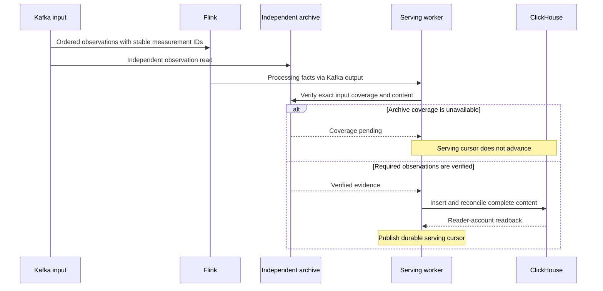
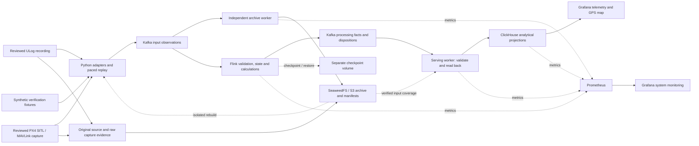
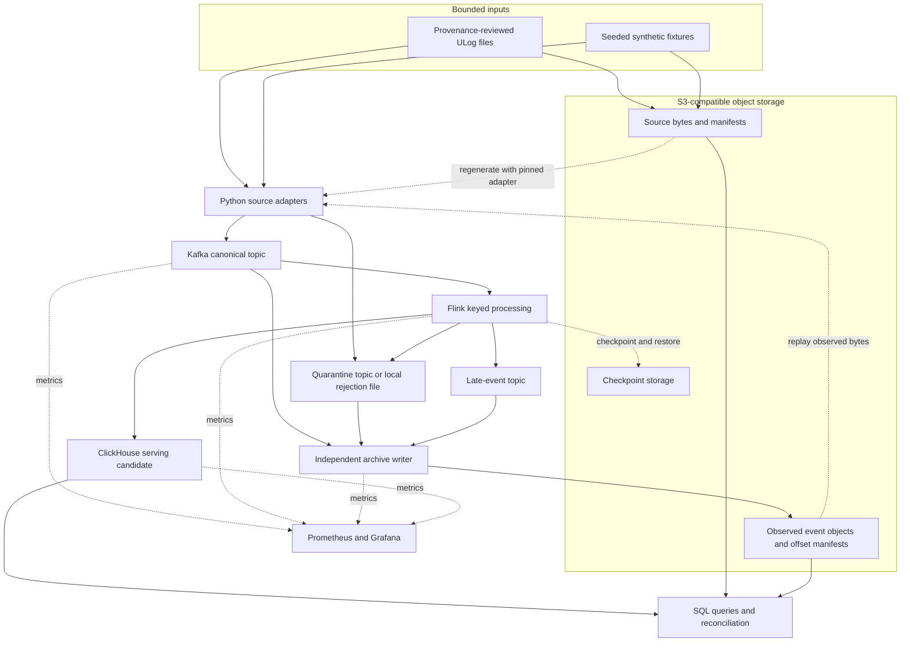

# Version 1 architecture

## Default local topology, 2026-11-11

The default installation is one machine under root `compose.yaml`, as selected
in [ADR-0051](adr/0051-single-machine-default.md). It starts one Kafka broker
with combined KRaft controller, two 12-partition topics, one Flink JobManager
and one TaskManager with two slots/parallelism two. The
[local quickstart](local-development.md) requires no private configuration,
second host or distributed certificate setup.

The starter's SQL battery projection demonstrates the streaming core using
existing canonical synthetic inputs. Archive, ClickHouse and Grafana remain
separate full-platform responsibilities; they are not mandatory processes for
the first run. Integrate those responsibilities on this same default machine
before treating the complete product as a fresh-clone installation.

The older host placements and six-broker/eighteen-partition checks below describe
specific retained experiments. They are not minimum installation requirements.
Their data, guarded interfaces, acceptance evidence and compatible repairs remain
unchanged; the starter uses its own project, topics and volumes.

## Current bounded integration, 2026-11-11

The [integrated F09 run](adr/0050-integrated-f09-runtime.md#local-evidence-2026-11-11)
has exercised the responsibilities below for one 60-second interval: independent
GPS, battery and recorded-state inputs, Kafka, Flink associations, input archival,
archive-gated ClickHouse serving and Grafana readback. It produced 538 logical
facts from 1,017 selected events and two repeated deliveries. This updates the
older next-increment descriptions below; it does not complete the full MVP.
Full-flight operation, checkpoint restore and broader failures remain open.

Python responsibilities are now separated into offline bundle policy
(`stream_contract.py`), original/prepared-source reconciliation (`stream_source.py`)
and preparation/readback CLI (`stream_prepare.py`). The recording association
state/checkpoint logic remains in `telemetry/recording_runtime.py`; strict output
validation lives in `telemetry/recording_output.py`. Runtime configuration,
publication and archival have separate modules, while `recording_worker.py`
keeps serving and role dispatch. Position capture/raw-packet validation lives
apart from its archive/SQL worker. Existing entry points remain available.

The maintenance report records the refactor scope,
compatibility checks and remaining verification limits.

## Integrated local MVP target, 2026-11-10

The maintainer-selected [technology-stack diagram](mvp-target.png) is the product
target under [ADR-0048](adr/0048-integrated-mvp-and-evidence-preservation.md). Its components
must form one observable source-to-query result, rather than separate successful
profiles. The runtime remains stopped after the coach demonstration. The target
does not declare the diagram fully implemented, production-ready or infallible.

The first integrated source is the exact F09 research recording. GPS, battery,
land-detector and commander observations retain distinct identities and native
time meanings. Flink owns the admitted stateful calculations and associations;
association ages, uncertainty masks, units and missing values must remain visible
through serving. SQL-backed replay updates are distinct from a physical live
aircraft connection. The reviewed SITL source follows after this recording path
works; each source retains its own contract, clock and capture limitations.

The main path owns MVP acceptance. Research loaders remain for inspecting new
files and preparing/comparing reference results; their direct-to-SQL output
cannot substitute for the processing path. Original source retention and exact
Kafka observation archival are separate responsibilities. Checkpoints support
compatible processing recovery and do not replace either archive.

| Boundary | Existing evidence | Remaining integrated MVP work |
| --- | --- | --- |
| F09 source interpretation | Original-file and GPS/battery/state preparation checks | Versioned stream/fact profiles that preserve these meanings through one replay |
| Kafka/Flink | Six-broker two-host battery replay and checked output prefix | GPS and recorded-state processing alongside battery in the selected run |
| Independent archive | Bounded synthetic and selected live-position profiles | Exact selected F09 input coverage with durable receipts and raw-source links |
| Serving and analytics | Historical F09 rows/readback and SQL-backed dashboards | Advancing query results from processed facts, gated by archive coverage |
| Monitoring | Six native targets and working service/Flink queries | Source/archive/serving progress, loss indicators and resource evidence for this run |
| Lifecycle and recovery | Scoped startup/stop and earlier bounded recovery profiles | One documented full-path startup/status/stop plus selected failure/rebuild checks |

Preserve complete ULogs and reusable run evidence even when only three telemetry
families enter the MVP online path. Keep unprocessed streams as source bytes with
schema/provenance rather than inventing interpretations or streaming all fields
without a consumer. [Retention policy](deployment-and-terraform.md#run-evidence-and-retention-policy-2026-11-10)
defines budgets, preservation status and cleanup boundaries; [roadmap criteria](roadmap.md#integrated-mvp-priority-2026-11-10)
define when this target is achieved. Later platform work can add reviewed stream
types, analytics, longer operation, stronger failure domains and optional cloud
deployment without changing retained measurement identity or rewriting history.

Existing two-host placement remains the initial runtime: laptop processing,
PC archive/serving/monitoring and the admitted distributed Kafka profile. Broker
counts and partitions are configuration/compatibility choices, not universal
MVP requirements. Local Compose remains the lifecycle owner. No additional
service or framework is adopted by this target.

The [offline stream preparation/reference](guides/f09-stream-replay.md) under
[ADR-0049](adr/0049-bounded-f09-stream-events.md) now preserves independent
F09 GPS/battery/state events and reproduces 538 complete reference snapshots
from a 60-second interval. It is ordered file processing; transport coordinates,
independent observation archival and processing-backed SQL still need integration.

The [live Grafana view](guides/continuous-position.md#live-grafana-screen) reads the
continuous position SQL projection through the existing plugin and reader scope.
Current panels use expiring SQL state; historical XY panels use numeric native
boot seconds. The direct observer and historical log screen remain separate.
A missing collector-status file during replacement causes no health renewal;
the store continues instead of crashing on that transient gap.

The [guarded continuous position follow-up](guides/continuous-position.md) under
[ADR-0047](adr/0047-continuous-local-position.md) separates live capture from
independent archive/SQL publication. Exact input/raw evidence gates output
admission; durable serving progress follows complete SQL readback. Expiring
collector/bridge receipt health clears current values on silence or worker
failure. Source-native time and identity remain unchanged. The local shared
network namespace preserves loopback client guards at the cost of network
separation; this is a bounded operating session, not a shared deployment.

The [bounded live source-to-query profile](guides/live-position-source-query.md) under
[ADR-0046](adr/0046-live-position-source-query-slice.md) connects 16 newly received
SITL positions to a separate native-clock input, one-partition Kafka/Flink graph,
independent existing S3 archive and fresh SQL scope. Full source-coordinate and
content reconciliation gates success; duplicate deliveries/inserts preserve
logical measurements. This finite profile does not change Battery state or
make SQL a continuous live-state authority. Continuous updates/recovery remain open.

The [live PX4 increment](guides/live-px4-mavlink.md) under proposed
[ADR-0045](adr/0045-live-px4-mavlink-observation.md) adds an isolated, receive-only
SITL observer ahead of later archival integration. Existing bounded HTTP/heartbeat
rules separate observed presence, collector health and each stream's receipt age.
Position retains declared boot-session/native-time identity; timestamp-less
messages receive no invented measurement time/identity. Restart reconstructs no
fresh state. This fast path neither changes canonical events nor bypasses the
separately scoped Kafka/Flink/archive admission for live event types.

The [two-recording continuation](guides/two-recording-view.md) under proposed
[ADR-0044](adr/0044-two-recording-research-view.md) adds the exact F01 state
adapter, optional shared SQL admission and one native-time recording selector.
The new registry follows full typed/raw readback; existing replay verifies
without inserts and conflicts/partial scopes refuse. Admissions are locally
serialized, not transactionally isolated. F01 uses commander observations with
empty GPS/missing battery; existing F09 identities and tables stay intact.

The [active product goal](roadmap.md#active-product-goal-2026-11-04) now prioritizes
supported source connection and state inspection. The first
[recording command](guides/recording-connection.md) composes the existing F09 adapters
and native-time association rules into local artifacts. Its combined Grafana
panel reads previously materialized tables; the command does not load SQL or
establish integrated real-source archive/Kafka/Flink delivery.

## Current two-host infrastructure admission, 2026-11-03

The target evidence places Flink services
on the laptop and archive/SQL/Prometheus/Grafana on the PC's verified H: storage.
Native metrics cross authenticated SSH loopback tunnels; storage APIs remain
loopback. Fresh storage readback and six reporter targets pass at the initial
foundation boundary, before Kafka job submission. Flink keyed state stays with
its operators; moving
storage to the PC does not offload that state or establish high-rate capacity.
The subsequent tiny two-host slice reconciles 128
measurements across Kafka, laptop Flink and PC archive/SQL workers. It corrects
controller advertisements and Flink's shaded password-provider name without
changing event semantics. Its test jobs finish stopped; the six-broker sizing
proposal, cross-host failure/recovery and production/release gates remain open.

## Status and design intent

M2 and M3 are accepted for their bounded local synthetic profiles.
M4 is accepted for the closed finite terminal-reference profile
under [ADR-0032](adr/0032-bounded-m4-completion.md), with archive-only serving replay
and immutable receipt/report admission. Production and concurrent-writer serving
remain open.
The current M3 evidence separates real Kafka
partition lanes, managed processing, persistent checkpoints and parent-owned
runtime control. [ADR-0022](adr/0022-persistent-m3-completion.md) and
[ADR-0023](adr/0023-bounded-kafka-enumerator-backport.md) pin the standalone
services and narrow connector repair. Earlier experiment boundaries below
remain historical; they do not define the current acceptance status.

This document specifies a planned source-to-query system with implemented local
normalization, bounded file conversion, accepted synthetic Kafka ingestion and
accepted bounded Flink processing/recovery. The M3 acceptance guide defines its
exact tested failure domains. Complete milestone acceptance, benchmark capacity and production recovery
remain open; the bounded archive/sink and integrated evidence is linked below. Accepted ADRs establish design
boundaries; proposed ADRs require experiments before technology adoption.

The first useful result is a small historical telemetry dataset that can be replayed, transformed, archived, queried, and reconciled after a controlled failure. Flight-specific protocols end at the source adapter. The platform processes measurements rather than controlling devices.

The subsequent finite source-to-query demonstration
connects the existing boundaries for one tiny synthetic run. The independent
archive completes before serving admission; Flink byte receipts and terminal
window/disposition facts reconcile before append-only demonstration tables are
written. Complete-row distinct readback precedes all reports. Parent-owned
finite integration does not make diagnostic traces a transactional continuous
sink, enforce concurrent query admission or complete M4.

The [bounded M5 reliability ledger](case-studies/m5-reliability.md) extends that evidence
with real online late arrivals, expiry of active deduplication state, rebalance
and checkpoint/backlog recovery. [ADR-0033](adr/0033-finite-flink-source-coverage.md)
adds a finite source admission/completion guard after an actual connector empty-
success defect: the whole original interval must remain available and exact
source receipts must reconcile before a command FINISHED receipt is issued.
The existing Kafka offset CLI supplies metadata; graph UIDs, serializers and the
validated enumerator repair stay intact. A post-execution refusal can follow
source commits and is not a rollback guarantee. Raw connector FINISHED status
alone is not approved finite-run completion.

## Components and event flow

The Flink collection-budget follow-up keeps native
reporters separate from application facts and enforces 20,000 post-relabel
samples, 8 MB response bodies and twenty labels per Flink target. Split-family
and identity-label filtering remain. Native scrape diagnostics and pressure
warnings expose rejection without substituting zeros for missing pipeline data.
The scoped short replay does not establish full-graph observability latency.

M6's initial observability boundary is a read-only,
bounded M2 capture exporter on loopback. It validates complete input before
exposing fixed-label snapshot gauges and omits source values on instrumentation
failure. File metadata age is separate from event time, process liveness and
visibility latency. The subsequent local monitoring integration
adopts Prometheus/Grafana and existing native Flink/ClickHouse reporters under
[ADR-0034](adr/0034-local-observability-stack.md). Monitoring has no Docker socket,
source bytes or serving-write credentials. Full pipeline/benchmark signals in
the diagram remain incomplete.

1. Register a source with checksum, rights, retrieval information and privacy classification. Keep original bytes unchanged in restricted storage before historical publication.
2. The adapter emits one supported measurement type at a time. It records native record identity, time mapping and normalization version; it does not invent a synchronized snapshot from asynchronous sensors.
3. The replay producer publishes a versioned JSON envelope, keyed by vehicle. It waits for Kafka acknowledgements and records a run manifest. Publication failure remains retryable and visible.
4. An independent consumer archives original Kafka keys, values and ordered headers under restricted access with cluster/topic identity, partition and offset. It commits offsets only after verifying durable object, manifest and receipt readback.
5. Flink validates envelopes, assigns event time, rejects conflicts, deduplicates within a declared horizon, and calculates per-vehicle windows. Rejections and late measurements have separate dispositions.
6. A sink writes versioned analytical facts. Queries apply explicit uniqueness rules. Reconciliation compares identities and semantic hashes with a bounded reference run.

Archiving and serving progress independently. Kafka acknowledgement does not prove archival or serving completion. A bounded run is complete only after archive coverage and analytical reconciliation are both recorded.

## Source adapters and canonical events

Initial adapters cover selected PX4 ULog messages and seeded synthetic records. A future MAVLink or SITL adapter must provide the same envelope and a durable device-session identity; protocol packet sequence numbers alone are insufficient across restarts or wraparound.

The [data contract](data-contracts.md) owns field meanings. Source timestamps may be boot-relative. An adapter needs either a documented UTC anchor or a fixed synthetic anchor; host arrival time must not be used to fabricate measurement time. Clock resets split source sessions. Invalid time mapping goes to quarantine before event-time processing.

The envelope separates immutable measurement content from delivery metadata. A replay changes the delivery run and ingestion time, while preserving measurement identity and source time. Mapping changes use a new normalization version and an isolated dataset lineage.

The [canonical battery reader](guides/canonical-reader.md) independently admits current
wire envelopes, checking positional identity and clock/unit/profile relations
while tolerating optional extensions. It returns only the recognized projection;
archive original bytes separately. Per-envelope validation does not authenticate
payloads or reconcile conflicts and complete native positions across a run.
The JSONL command reports counts only after bounded whole-file validation.

## Implemented Python module boundaries

The root `fleet_telemetry.py` preserves the public normalization imports.
`telemetry_convert.py` owns CLI dispatch and run publication/verification
orchestration. Its internal package separates the following responsibilities:

| Module | Responsibility |
| --- | --- |
| `telemetry/models.py` | Typed envelopes, source manifests and normalization profile constants |
| `telemetry/validation.py` | Shared native context validation and safe validation errors |
| `telemetry/synthetic.py`, `telemetry/ulog.py` | Separate pure source value mappings |
| `telemetry/conversion_contract.py` | Job/run types, strict JSON shapes and canonical artifact serialization |
| `telemetry/jobs.py` | Job decoding, source registration and delivery preflight |
| `telemetry/artifacts.py` | Bounded source outcomes, identity reconciliation and complete artifact preparation |
| `telemetry/local_io.py` | Bounded local reads and atomic no-replace filesystem publication |

Mapping modules perform no transport or filesystem operations. Conversion
internals do not import their root CLI. The optional ULog parser remains a
deferred import at the binary source boundary. `ulog_integrity.py` and
`ulog_reader.py` retain their separate framing and upstream-decoding roles.

The Kafka command paths remain unchanged. Helpers in `scripts/` separate
probe receipt contracts (`kafka_probe_contract.py`), native producer/inspection
operations (`kafka_producer_transport.py`), offline semantic reconciliation
(`kafka_reconciliation.py`) and evidence writes (`kafka_evidence.py`). The offline
auditors and `telemetry_reference.py` remain independent of live Kafka clients.
The consumer reader continues to validate identity/time/unit relationships
independently of native mapper validation.

The maintenance review records regression
evidence and the Python module size guard. This organization changes no event,
job/run, receipt, pipeline or normalization version and adopts no new runtime.

## Kafka responsibilities

[ADR-0012](adr/0012-kafka-ingestion-candidate.md) records the maintainer's Kafka
`4.4.0` selection with proposed `confluent-kafka 2.16.0` for the
bounded M2 compatibility experiment.
The local probe now verifies client installation,
the pinned-base release image, exact synthetic delivery and clean consumer
reopen at committed offset 3. The
consumer recovery follow-up validates receipt/source
and live cluster/topic UUID before resuming a manually assigned partition at
offset 0 or 3. Before/after-commit process exits and corrupt receipt refusals
pass. A graceful broker restart preserves the same
three captured records, topic UUID and committed offset on the original volume.
The isolated retention-gap check verifies refusal with
the missing interval after the required records expire, keeping committed offset
0 unchanged. A [broker SIGKILL check](case-studies/kafka-broker-sigkill.md) preserves the same
captured records and committed offset after one abrupt JVM exit on the original
volume. The consolidated matrix also exercises producer
exit after ACK before local progress, exact-byte retry, semantic reconciliation,
unavailable endpoint and queue-full failure. Lost broker ACKs, rebalances and
host/disk loss remain unvalidated.
M1 acceptance gates remain open.

[ADR-0013](adr/0013-local-kafka-release-image.md) scopes a local image build from
the same official 4.4.0 binary release after the ready-made tag was unavailable.
It preserves broker/version and event boundaries. Experimental admission passed;
that result is separate from M2 acceptance.

Proposed logical topic names follow this pattern; replay environments add a separate namespace rather than sharing a live topic.

| Topic | Contents and owner | Key | Retention intent |
| --- | --- | --- | --- |
| `telemetry.canonical.v1` | Adapter output; Flink and archive writer use independent consumer groups | `vehicle_id` | Delete policy; recovery buffer, not permanent storage |
| `telemetry.quarantine.v1` | Parse, contract and identity conflicts with safe references | Known vehicle, otherwise source reference | Bounded operational retention; restricted archive |
| `telemetry.late.v1` | Valid events excluded from online windows with watermark context | `vehicle_id` | Bounded buffer; preserve for reconciliation |

Start M2 with one partition and one local KRaft broker. Later multi-partition tests must include idle partitions, skew and rebalances. Partition count, retention bytes and time are recorded per run. Retention must exceed the tested maximum recovery interval and archive lag, with a measured margin; a disk limit can shorten the effective recovery window.

The initial key keeps one vehicle's records in one partition, but Kafka order is arrival order, not measurement-time order. Expanding partition count can change key placement, so treat it as a migration. Large single-vehicle workloads may become hot keys; do not shard a vehicle until state and ordering consequences are tested. Kafka's partition / offset model and delivery semantics are described in its [design documentation](https://kafka.apache.org/design/).

Enable and test producer idempotence when implementing ingestion. It reduces transport retry duplication under supported settings; it does not remove application-level replays, duplicate source records, or sink retries. Kafka transactions are not a general transaction spanning an external archive and database.

## Event time and window policy

`source_timestamp` is required and represents physical sample time mapped to UTC when available, or source publication time only when no sample time exists. Preserve `source_time.timestamp_kind: measurement` or `publication`; a fixed synthetic anchor reconstructs UTC without changing that distinction. `ingest_timestamp` marks first admission by the adapter for that delivery run. Processing and sink visibility timestamps are operational observations. Historical source age is not processing latency.

The separate [`ulog-battery-v1` profile](data-contracts.md#proposed-ulog-mapping-ulog-battery-v1)
is proposed pending firmware/field review and local discovery evidence. It must
confirm native current semantics and convert to the shared positive-discharge,
negative-charging convention. Native scaling and sentinel rules are independent
of the accepted synthetic mapping. No ULog adapter or discovery execution is
part of the implemented synthetic slice.

Local discovery has inventoried two upstream test
logs. [ADR-0006](adr/0006-ulog-discovery-tooling.md) records the isolated research
environment; [ADR-0009](adr/0009-bounded-local-conversion.md) separately selects
the optional bounded runtime reader. Actual-source mapping acceptance and data
redistribution remain gated separately. The subsequent
pure record mapper is implemented with authored
synthetic cases; it does not parse or attribute real log records.

The isolated Python 3.13 parser probe demonstrates
that parser success and its corruption flag do not establish complete input or
original record ordinals. [ADR-0008](adr/0008-ulog-input-integrity-gate.md) now
records the implemented bounded integrity gate: verify registered checksum/size,
complete frames and supported definitions before running the upstream parser.
The [ADR-0010 extension](adr/0010-ulog-nested-and-service-frames.md) adds bounded
nested layouts and validated `M`, `L`, `S` frames to `B`, `F`, `I`, `P`, `A`,
`D`, `O`, with the same 16 MiB input and 100,000-frame limit. Depth, scalar
expansion and qualified-field-name budgets also bound upstream parser work.
Unsupported messages, flags, subscription changes
and appended sections fail visibly. Dropouts remain loss evidence.

The optional `ulog` extra pins pyulog `1.2.2` and NumPy `2.3.5`. The bridge checks
the complete embedded definition digest, required field types, native boolean
encoding, selected-stream clock order and every framed stream's decoded count
before returning immutable selected records with original ordinals. Value
rejections retain these positions. Real-source firmware metadata must match the
manifest; producer attribution and usage rights remain caller attestations.
Neither metadata nor a source enum independently proves the physical producer.

The [local converter](guides/bounded-conversion.md) accepts strict versioned JSON jobs
for synthetic native JSON or the supported ULog subset. It reconciles all
selected source records into events or safe rejection references and records
artifact hashes, stable semantic content and explicit run metadata. The 64 MiB
serialized-output budget bounds the experiment. Completed files are staged beside
a new destination. Windows directory rename and Linux `renameat2` with
`RENAME_NOREPLACE` publish without replacing an existing run; unsupported
operations fail explicitly. Its directory name matches `dataset_run_id`; a whole-source
failure releases no completed run. This is serial local file conversion, with
no service concurrency, crash-durability or acquisition-loss guarantee.

The [read-only verifier](guides/run-verification.md) reuses bounded preparation to
compare an existing run's three files with regenerated bytes from its external
job/source. It releases no new run and performs no repair. Exact environment
and configuration provenance are part of the comparison; the same trusted
local parent assumption applies.

The first M3 experiment proposes these settings, as fixture parameters rather than production defaults:

The [bounded reference](reference/m3-window-reference.md) makes a controlled trace of these
rules executable without introducing a stream engine. It keeps integer epoch
milliseconds for window/timer comparison and original microseconds for semantic
identity comparison. It consumes explicit global watermarks; actual periodic
generation and idleness remain Flink integration gates.

| Parameter | Initial proposal | Meaning |
| --- | --- | --- |
| Window | 10-second tumbling intervals | UTC epoch-aligned, start inclusive and end exclusive |
| Out-of-order bound | 2 seconds | Per active input watermark trails maximum valid event time |
| Idle-input timeout | 30 seconds of processing time | Idle inputs stop holding back global event-time progress |
| Allowed lateness | Zero | An event for a closed window is routed to the late-event path |
| Deduplication horizon | 10 minutes of event time | Bounded keyed state; not a permanent uniqueness guarantee |

Flink uses watermarks to track event-time progress; quiet inputs need an explicit idleness strategy. See [Generating Watermarks](https://nightlies.apache.org/flink/flink-docs-stable/docs/dev/datastream/event-time/generating_watermarks/). Test event timestamps at window and watermark boundaries against the pinned API before treating the table as executable behavior.

Flink window output will include the vehicle, dataset run, pipeline version, interval, unique event count, non-null value count, and selected battery summaries. Missing measurements do not contribute zero values. A gap signal is diagnostic: without a known source sampling expectation, it cannot prove that a device failed or data was lost.

Validate timestamps before they can advance a watermark: malformed, unanchored or manifest-inconsistent future values must not close other vehicles' windows. Wall-clock skew checks apply only to live runs; historical validation uses source/session bounds. An idle partition returning with older records may produce late events. A bounded reference run explicitly signals completion and flushes terminal windows; silence in an unbounded Kafka topic does not do so.

Late events are preserved with their identity, observed watermark, window and reason. Version 1 does not silently revise closed online windows. A later bounded reconciliation run may publish a corrected dataset under a new run ID. Exact arrival order and watermark decisions must be captured when comparing online dispositions; offline full-history aggregates are a different result definition.

## Stateful processing and deduplication

Key state by dataset run and vehicle. Within that state retain event identity, semantic content hash and an event-time expiry timer. Exact repeated identities with identical semantic content count as duplicates. A repeated identity with different content is a contract conflict, not a replacement. Quarantine it and invalidate the bounded run for release; reconciliation must detect conflicting variants even if they arrive after deduplication state expires.

The proposed timer expires identity state after the deduplication horizon. Very late duplicates may reappear after state cleanup; late routing and sink query uniqueness must still prevent silent inflation. If watermarks stall, event-time cleanup also stalls. Monitor state size, active timers and watermark lag; set a tested memory limit and backpressure / stop policy rather than promising bounded memory from TTL alone.

A full rebuild starts with fresh state in an isolated run. Restoring a checkpoint and then rewinding unrelated source offsets is prohibited: it can pair old state with an incompatible input history.

The bounded battery operator implements these state
roles for a finite synthetic collection, using managed maps and event-time
callbacks. It disables periodic watermarks, captures the actual initial and
terminal watermark values, and compares final windows with the independent
reference. Collected windows remain provisional; any conflict rejects release
of the entire run. A 1,023-observation/1 MiB source budget bounds its history,
including when event time stalls. This experiment is not the unbounded Kafka
processor. That terminal profile does not establish intermediate expiry/late
routing, input idleness, checkpoint restore or measured memory limits.

The subsequent paced watermark profile now exercises
intermediate expiry and late routing using the same operator and actual periodic
watermarks. It captures entry counts, retains full finite-run history after active
cleanup and refuses new history entries above an explicit per-key cap. Fixed-name
runtime counters distinguish gate admission from window eligibility. Its owned
loopback source is test-only; no checkpointable input or persistent processor is
adopted by that profile. Multi-input idleness, source/state restore and measured
limits were not established by that earlier experiment.

The checkpoint recovery experiment now observes a
completed checkpoint at Kafka next offset 3, a distinct Python worker PID exiting,
REST/state/source restore at 3 and finite completion at 9 with exact reference
windows. It uses a single partition and terminal watermarks; TaskManager/host
recovery, idleness and sink semantics remain unvalidated. Earlier local SDK worker
settings did not by themselves establish an independent OS process.

The initial shared-broker attempt expired four historical topic segments under
existing one-hour retention. Original preservation failed. The original broker is
stopped; its post-expiry copy cannot recover expired history. Kafka is a bounded
log, not the archive. [ADR-0019](adr/0019-isolated-checkpoint-broker.md) scopes a
separate Compose project/volume for new experiments and records costs/rollback.
Technical recovery success does not turn this into clean overall acceptance.

The two-input idleness experiment independently assigns
timestamps/watermarks to two bounded loopback sources before union, using the
existing two-second bound and 30-second idle timeout. It observes the active
minimum, exclusion after silence, monotonic progress on resume, late/duplicate
precedence and final-window retention during all-input silence. Five windows
and ten identities match the unchanged reference. This proves the scoped
Flink input-combination boundary, not Kafka split-level idleness, rebalance,
checkpoint recovery or a persistent runtime. The separately accepted persistent
profile supplies those additional local proofs; host-loss and sink claims stay open.

## Archival, retention and evidence

The archive has two distinct layers:

- Original source files plus manifests allow regeneration with a pinned adapter. This remains possible even if a mapping defect prevented publication.
- Observed Kafka records preserve exact key/value bytes, ordered headers under restricted access and cluster/topic/partition/offset evidence. These show what was actually admitted, including repeated deliveries and rejected records on operational topics.

Use separate namespaces for `sources/`, `events/`, `manifests/`, and `checkpoints/`; do not apply raw-data retention or immutability policies to active checkpoints. Historical runs retain their sources throughout the experiment. For future live inputs, the archival lag defines a potential unrecoverable tail if Kafka and local buffers are both lost.

The proposed archive writer creates immutable batches identified by topic, partition and offset range, plus byte checksum and format version. On retry it verifies an existing object's checksum. It writes or verifies a receipt before committing the next offset. Receipt discovery must repair a crash between object persistence and receipt persistence. Rebalancing or changed batch boundaries may create overlapping ranges: coverage and unique offsets, not object count, establish completeness. Never overwrite an object with different bytes under the same key.

Kafka retention is finite and independent of consumer progress. Archive lag approaching that boundary is a data-loss alert. A local object-store volume on the broker host is not an independent backup. The bounded SeaweedFS/SDK gate proves only the tested conditional-create, permission and replacement/readback boundary. Long-term retention, privacy deletion and any off-host backup policy require explicit ownership.

[ADR-0020](adr/0020-bounded-tests-and-s3-archive.md) selects Amazon S3 for the
final source/observation archive and a conservative 50 GiB retained-Kafka-data
planning ceiling for local tests. The local SeaweedFS/client foundation is
accepted under ADR-0024; the complete archive remains pending. Ordinary finite test topics are planned without
automatic time/size expiry, with explicit admission/disk bounds and separate
expiry-test topics. The [fixture implementation](guides/local-kafka-fixture-profile.md)
now applies this to both maintained three-record creators and verifies effective
settings. Tiny live recovery/expiry/restart checks pass; 50 GiB capacity remains
unvalidated. Existing topics and broker defaults are unchanged.

The proposed [archive recovery contract](reference/archive-recovery-contract.md) defines
lossless observation identity, verified contiguous coverage, readback before
progress commits and a rebuild with the original Kafka source inaccessible.
Normal checkpoint recovery must refuse missing required offsets; archive rebuild
is a separate operation into a fresh run, not a reset or an automatic fallback.
The observation encoding subset is implemented by `telemetry/archive_codec.py`;
the SDK boundary is separate under `runtime/s3/`. The
graph/coordination increment implements catalog/lineage
checks, finite publication/progress ports and file reconstruction. The subsequent
bounded runtime adds concrete Kafka/S3 publication,
protected descriptor retention, explicit progress and actual expiry reconstruction.
Full M4 and production recovery remain open.

The [production recovery gate](guides/production-recovery-gate.md) requires independent
archive placement for the stated failure domain, workload-derived time/byte/disk
budgets, fresh remaining-margin evidence and a timed response drill. Unknown
bounds block admission. Local quarantine does not enforce Docker permissions.
These controls remain unimplemented/unvalidated; production reliability is open.

### Bounded Kafka source follow-up

The bounded Kafka source boundary implements only the pure
typed read port in `runtime/kafka_archive/`: `types.py` owns source inspection
and client interfaces; `reader.py` owns finite exact coverage, source identity,
retention/progress and deadline checks. It performs no commit, reset, archive
write or lineage admission. The Windows SDK candidate failed the full topic-UUID
comparison against Kafka itself and is not adopted. The subsequent
Linux verification passes full UUID, exact
read and actual post-preflight expiry checks on the retained candidate.
The subsequent [Windows UUID repair](case-studies/windows-kafka-uuid-repair.md) accepts only
a narrowly patched local SDK plus lazy full-width admission in M2/M3; the Kafka
server and observation identity contract are unchanged. Corrected Windows and
stock Linux pass the exercised boundary; stock Windows refuses before clients.
The subsequent native reader admission adds
`native.py` to this boundary. It rechecks the existing UUID guard after pure
platform/input validation and before client construction, refuses changed native
source identity and unsupported cleanup, and preserves the read-only port.
Independent native tests and actual Linux/corrected-Windows UUID/read/expiry
checks pass with unchanged committed progress. Stock Windows refuses before
clients. The subsequent Linux runtime supplies the separate commit adapter and
supervised publication/rebuild; the read-only native adapter stays unchanged.

### Supervised archive runtime

[ADR-0027](adr/0027-bounded-archive-runtime.md) adds a trusted parent for the
finite command, role credentials, descriptor retention and monotonic deadline.
Networked writer/fresh-reader workers have a production-only read-only closure;
the final archive reconstruction has a private network namespace and only freshly
fetched graph objects. Parent roots and original source/oracles are never mounted.
Fresh reader verification precedes retention, exact retained readback precedes
commit, and expiry refuses ordinary recovery without reset. Actual Kafka-off
reconstruction and storage-restart readback pass against a frozen independent
oracle. The runtime guide records bounds, failures and
checks. Host/disk-loss durability, production capacity and serving remain separate.

## Analytical serving and sink semantics

Current bounded adoption: [ADR-0032](adr/0032-bounded-m4-completion.md) supersedes
ADR-0028's candidate-only local status after M4 acceptance.
Fresh whole-archive verification derives canonical and terminal-reference facts.
Replay targets are isolated from original archive/source runs before INSERT.
A separately stored immutable run receipt and external digest gate the approved
report CLI, which compares complete canonical/processing facts around SQL.
The original scope is SELECT-only. This is closed-run admission with trusted
administrators, not a continuous sink transaction, concurrent run lock or a
shared-deployment authorization boundary. Earlier increments below retain their
original narrower evidence and limitations.

The serving compatibility experiment under
[proposed ADR-0028](adr/0028-serving-compatibility-spike.md) now validates an
append-only MergeTree candidate on a tiny local fixture. Real lost-response
retries, changed batching, pre-merge uniqueness, conflicts across merges,
separate role grants and fresh-process container-replacement readback pass.
A separate namespace conflict check precedes analytical reads on closed inputs.
Independent admission, canonical projection and complete archive-to-query
reconciliation remain open. This does not adopt a production sink.

The subsequent pure serving projection, defined in
[its interface](reference/serving-projection-interface.md), derives immutable rows only
after fresh trusted archive verification. Original job/descriptor hashes and
source dataset run remain separate from target scope. Lossless exact6 refusal
is a serving capability limit, not a canonical event change. ADR-0029 and the
independent admission record govern this bounded projection; a versioned sink
schema/transport and complete archive-to-query reconciliation remain separate.

The subsequent canonical event sink under
[ADR-0030](adr/0030-bounded-canonical-event-sink.md) implements that event-only
boundary: actual schema admission, synchronous writes, separate readback and
exact full-row reconciliation. All lineage is content under the target event
key; changed archive roots require an isolated target run. Ambiguous writes
produce no receipt and never auto-retry. The scoped live/frozen evidence does
not provide window/disposition integration, a persisted run seal, concurrency
control or an enforced whole-command deadline.

ClickHouse is adopted for the closed bounded local profile under ADR-0032.
Production serving remains unadmitted. The completed local gates demonstrate
event/window reads after ambiguous acknowledgement and changed retry batching,
using at-least-once writes, logical uniqueness and complete reconciliation.

Event facts use `(dataset_run_id, pipeline_version, event_id)` as their logical key. Window facts use the same run/version namespace plus vehicle, metric definition, window start and window end. Versioned window rows contain a complete aggregate replacement, not an increment. Retried rows must have identical content; revisions require a monotonic logical revision and a conflict policy, never wall-clock arrival order.

If `ReplacingMergeTree` is selected, every field in the sorting key must remain stable across copies, and duplicate keys must land in the same intended storage partition. Background merges do not establish immediate query uniqueness; use a reviewed `FINAL` or explicit grouping query and test it before merges occur. See the [table engine documentation](https://clickhouse.com/docs/reference/engines/table-engines/mergetree-family/replacingmergetree). Avoid incremental materialized-view sums over retryable rows: later source deduplication does not automatically undo earlier increments.

ClickHouse insert retry deduplication is bounded by its deduplication window and depends on engine and insert settings. It cannot replace logical keys, stable retry contents or reconciliation. See [Deduplicating inserts on retries](https://github.com/ClickHouse/clickhouse-docs/blob/main/docs/guides/developer/deduplicating-inserts-on-retries.md). Start with acknowledged synchronous batches; choose an asynchronous mode only with separate durability and retry evidence.

Event facts preserve all valid unique measurements, including late measurements with a disposition. Window facts include only measurements eligible under the online watermark policy. Duplicate observations remain in the observed-event archive; conflicts remain in restricted rejection evidence and invalidate the affected run. Queries must not confuse the event-fact population with the window-eligible population.

The Flink API, runtime, Kafka connector, object-store plugin, JVM and ClickHouse
write path must be checked across the M3/M4 integration boundaries. ADR-0018
selects PyFlink for the compatibility experiment. The
isolated Linux profile now validates Python worker
execution, timestamp/invalid-side-output behavior and a bounded Kafka Table
metadata source bridged into Python DataStream. It introduces no Java
application code. Source, runtime/bootstrap and result-checking responsibilities
remain separate under `runtime/pyflink/`; root M1 dependencies are unchanged.
The Flink-integrated ClickHouse write path and object-store checkpoint plugins
remain unvalidated by the bounded event library. If serving integration needs disproportionate custom code, record
alternatives in an ADR before adopting another framework.

## Recovery and the guarantee boundary

Checkpoints snapshot managed application state and associated source progress. Use persistent checkpoint storage outside container filesystems and verify restore after TaskManager failure. Savepoints are a separate planned tool for controlled upgrades; stable operator identities and state compatibility require tests. Checkpoints are neither raw archives nor a substitute for replayable inputs. See [Flink checkpointing](https://nightlies.apache.org/flink/flink-docs-stable/docs/dev/datastream/fault-tolerance/checkpointing/).

Flink's exactly-once state mode concerns the effects on managed state during recovery. End-to-end exactly-once effects additionally require a replayable source and transactional or idempotent sinks. This project makes no such end-to-end claim; ClickHouse and archive writes need independent proof. See [Flink fault tolerance](https://nightlies.apache.org/flink/flink-docs-stable/docs/learn-flink/fault_tolerance/).

| Boundary | Intended behavior | Required proof |
| --- | --- | --- |
| Source to Kafka | Acknowledged, retryable admission; application duplicates possible | Publication manifest and broker restart experiment |
| Kafka to Flink state | Consistent state recovery under selected checkpoint mode | Reference comparison after checkpoint failure and restart |
| Kafka to archive | At-least-once observation, unique offset coverage | Crash tests around object, receipt and offset commits |
| Flink to ClickHouse | At-least-once physical rows; unique analytical results | Retry, conflict, pre-merge query and identity reconciliation tests |
| Archive to new dataset | Reproducible semantics for pinned inputs and policies | Isolated rebuild and stable-content comparison |

Normal recovery uses matching checkpointed offsets while those Kafka records remain available. If retention has removed required offsets, stop and report the gap; do not silently reset to latest. Recovery then requires an isolated archive rebuild and reconciliation. Losing both checkpoint state and input history is outside recoverable guarantees.

Replay manifests pin source checksums, mapping and schema versions, clock anchors, input ordering, seed, pipeline version, window/watermark settings and environment versions. Determinism means identical stable measurement content and reference aggregates under those inputs. It does not mean identical ingestion timestamps, checkpoint IDs, processing-time metrics, or arbitrary online late-event decisions.

## Observability and failure handling

The bounded M2 operational guide inventories existing receipts
and adds a standard-library offline consumer audit. It regenerates exact
checkpoint bytes from the external job/run and explicitly supplied captured
context under ADR-0014. Its per-audit counts distinguish original ACKs from
recovery observations; precommit progress is unknown. This read-only result
never authorizes a broker commit or establishes live identity, lag or timing.
It adds no runtime component or telemetry wire version. The later
producer publication audit independently binds the
two recorded ADR-0015 attempts and six observations to the original source. Its
versioned manifest remains offline accounting, not recovered producer progress
or authorization to retry. The acceptance cycle adds actual
process metrics on stderr and validates them at producer failure/consumer commit
windows in a fresh broker run. Metric dimensions remain finite; captured lag
and operation duration are distinct from continuous monitoring and benchmarks.

Collect counters for parsed, admitted, archived, valid, rejected, duplicate and late observations; Kafka offsets and lag; Flink restarts, checkpoint age/duration/failures, watermark lag and state growth; sink retries and visibility delay; archive coverage gaps and resource usage. Structured logs correlate run IDs and safe event references. Keep high-cardinality identities out of Prometheus labels.

| Failure | Expected response and observable signal |
| --- | --- |
| Corrupt log or unknown schema | Preserve a safe reference, record rejection, block unsupported interpretation |
| Producer retry or consumer rebalance | Resume from durable progress; count repeated delivery and reconcile identities |
| Broker or disk failure | Backpressure / stop with visible errors; single-broker loss may require source rebuild |
| Flink process failure | Restore matching state and offsets; compare final output with reference |
| Object store outage or full disk | Archive commits stop; lag and checkpoint failures surface; prevent retention overrun |
| ClickHouse timeout after commit | Retry safely; queries and reconciliation detect repeated or conflicting rows |
| Timestamp jump or idle source | Validate time, inspect watermark behavior, preserve late dispositions |
| Unavailable metrics stack | Workload status remains inspectable through logs; report monitoring outage |

Latency reports separate adapter-to-sink visibility, event-time freshness, and historical source age. Recovery reports separate state restore time from backlog catch-up. [Testing strategy](testing-strategy.md) defines denominators and evidence.

## Deployment, security and provenance

Use incremental Docker Compose profiles with Linux containers on the Windows workstation, preferably through WSL2. No workstation capacity has been measured. Kafka disk writes, Flink state/checkpoints, ClickHouse merges, object storage and monitoring will compete for memory and I/O. Add services only as their milestone requires them; avoid interpreting an overloaded workstation as a distributed-system benchmark. [Deployment and Terraform](deployment-and-terraform.md) covers resource checks, version selection and the optional AWS stage.

Keep secrets outside the repository. Isolate component credentials and storage prefixes; bind published local ports to loopback. Treat coordinates, device identifiers and source URLs as potentially sensitive. Retain original bytes under restricted access, use approved synthetic or reviewed redacted derivatives for public demos, and record redaction lineage without rewriting the original. Do not publish logs merely because they were publicly accessible.

## Open decisions and gates

[ADR-0008](adr/0008-ulog-input-integrity-gate.md) records the implemented bounded
integrity boundary based on the parser fault probe.
[ADR-0009](adr/0009-bounded-local-conversion.md) selects the optional pinned reader
and Windows local run writer. Neither supersedes an accepted architecture choice.
[ADR-0016](adr/0016-linux-no-replace-publication.md) partially supersedes only
ADR-0009's Windows-only publication restriction, adding a Linux no-replace
operation with explicit unsupported-system/filesystem failure.
[ADR-0010](adr/0010-ulog-nested-and-service-frames.md) partially supersedes only
ADR-0008's initial flat/message subset, retaining its integrity and ordinal rules.
[ADR-0011](adr/0011-bounded-canonical-battery-reader.md) implements the independent
canonical consumer boundary without changing wire semantics or source adoption.
[ADR-0012](adr/0012-kafka-ingestion-candidate.md) records the selected Kafka
`4.4.0` version and proposed client/experiment plan; runtime stack adoption still
requires local evidence.
[ADR-0013](adr/0013-local-kafka-release-image.md) partially supersedes only the
image-acquisition route for the authorized synthetic compatibility experiment.
[ADR-0014](adr/0014-bounded-consumer-receipt-recovery.md) scopes versioned local
consumer receipts and the before/after-commit interruption experiment. Its
recovery boundary is a manually assigned three-event topic, not a general archive.
[ADR-0015](adr/0015-bounded-producer-retry-verification.md) scopes explicit producer
retry after loss of local publication progress and the consolidated synthetic
verification protocol; it adds no general automatic ingestion recovery policy.
[ADR-0017](adr/0017-synthetic-m2-acceptance.md) accepts M2 for the local synthetic
profile and supersedes only its all-of-M1 prerequisite for synthetic M2/M3
sequencing. Real-source adoption and hosted M1/service CI remain release gates.
[ADR-0018](adr/0018-flink-processing-candidate.md) records the maintainer's PyFlink
direction, with a separate Python 3.12 environment and a Flink/JVM/Kafka matrix.
Its dated compatibility follow-up now records bounded worker and connector
execution. The pure reference remains independent of that candidate; neither
reference nor compatibility success establishes full processing/recovery
behavior or M3 acceptance.

Additional decision record: [ADR-0006](adr/0006-ulog-discovery-tooling.md) selects
isolated tooling for the original discovery only; its dated follow-up links the
separate optional runtime adoption. The observed research results remain in the
discovery review.

[ADR-0007](adr/0007-ulog-battery-value-policy.md) proposes bounded current and
disconnected-record rules for the primary reviewed firmware/library path.
No accepted decision is superseded. A separately authorized
pure mapping experiment now asserts its authored
outcomes, with wire `1.0.0` and a distinct semantic projection. Actual source
adoption remains gated by producer, full firmware-definition and rights evidence.

| Decision | Must be resolved before | Blocking scope |
| --- | --- | --- |
| Real-source rights, producer attribution and complete firmware definition | Public ULog mapping acceptance | IDF_DS source/license and 39 declared fields reviewed for restricted research; actual producer/profile adoption remains open |
| Primary-candidate format support | Real-source binary admission | Primary structure and all-stream counts pass after the format extension; source adoption remains separate |
| Real-source time anchor and normalization / identity evidence | Real-source M1 acceptance | IDF_DS GPS variation measured; byte/frame/Q and firmware boundaries still refuse canonical admission; real-source replay remains open |
| Python toolchain and pinned broker / client compatibility | M1 / M2 respectively | M1 toolchain and accepted local synthetic M2 profile pass; source adoption and hosted M1/service CI remain release gates |
| Flink API, JVM, connectors, millisecond timer precision and terminal-window handling | M3 | Bounded local synthetic M3 accepted; ADR-0018 API plus ADR-0022 persistent runtime and ADR-0023 local connector repair; production/real-source/host-loss guarantees remain open |
| Archive format and retry receipts | M4 | [ADR-0021](adr/0021-bounded-archive-format.md) defines bounded JSONL/base64 and immutable catalogs; [ADR-0027](adr/0027-bounded-archive-runtime.md) adopts the supervised Linux fixture runtime with actual commit/expiry/reconstruction evidence; full M4 remains open |
| ClickHouse table/query semantics and sink protocol | M4 | [ADR-0028](adr/0028-serving-compatibility-spike.md) records passing bounded live compatibility checks; independent admission and canonical integration remain open |
| Canonical serving projection and precision | M4 pure boundary | [ADR-0029](adr/0029-lossless-serving-projection.md) scopes trusted archive lineage and lossless exact6 admission; sink integration remains separate |
| Canonical event sink schema/transport | M4 event boundary | [ADR-0030](adr/0030-bounded-canonical-event-sink.md) records bounded schema/write/readback evidence; windows, approved queries, supervisor and full slice remain separate |
| Finite source-to-query integration | Bounded demonstration | [ADR-0031](adr/0031-bounded-source-query-slice.md) reuses existing archive/processing/sink, reconciles three reports and retries; full M4 remains open |
| Bounded local M4 adoption | Accepted finite profile | [ADR-0032](adr/0032-bounded-m4-completion.md) admits archive-only isolated replay and sealed reports; supersedes ADR-0028's candidate-only local status |
| Finite Flink source loss refusal | Accepted bounded repair | [ADR-0033](adr/0033-finite-flink-source-coverage.md) adds retained-bound and exact receipt checks after actual empty-success expiry behavior; no checkpoint-format change |
| Independent archive restore, workload retention/disk bounds, remaining-margin response and actual connector gap refusal | Production admission | Bounded runtime checks actual expiry/fetch-gap refusal and Kafka-off S3 reconstruction; independent production failure-domain, capacity and response evidence in the [gate](guides/production-recovery-gate.md) remains open |
| Dedup horizon, watermark settings and retention sizing from baseline evidence | M5 / M6 | Blocks reliability / capacity claims, not a small fixture spike |
| Local collector/dashboard distribution and access limits | M6 | [ADR-0034](adr/0034-local-observability-stack.md) adopts the bounded pinned Prometheus/Grafana profile after live native scraping, label review and outage/alert/recovery; full pipeline signals and load baseline remain open |
| Continuous local processing and segmented archive | Large streaming calibration | [ADR-0035](adr/0035-continuous-local-runtime.md) remains proposed: six brokers/eighteen partitions and actual checkpoint recovery are implemented; fixed eighteen-lane watermarks pass backlog admission; the separate 2.084 GB load failed at the identity-state cap; full SQL coverage and reconciliation remain open |
| Continuous Battery state access | Measured v3 processing bottleneck | [ADR-0036](adr/0036-managed-vehicle-state.md) proposes one typed managed ValueState per vehicle; local RPC/performance and semantic checks pass; v4 requires fresh state and full graph/budget admission |
| Live connection loss | Authorized M6 local increment | [ADR-0037](adr/0037-live-link-watch.md) proposes independent monotonic heartbeat deadlines; local HTTP/container checks pass, actual gateway and durable notification delivery remain open |
| Live measurements through Flink | Authorized M6 local increment | [ADR-0038](adr/0038-flink-live-output.md) proposes immediate at-least-once output after Battery, native bridges and a bounded latest view; small runtime latency and semantic checks pass |
| Two-host Kafka laboratory | Deferred M6 distributed experiment | [ADR-0039](adr/0039-two-host-kafka-lab.md) proposes one six-broker cluster split 3+3, controller placement 2+1, host racks and mutual TLS; base/runtime recipes, native/JVM settings, credential issuance and transfer packaging are implemented; actual certificate-mounted runtime and network/recovery admission remain open |
| Simulated position map | Isolated local experiment | [ADR-0040](adr/0040-simulated-position-map.md) proposes separate simulator-only Kafka topics and Flink job feeding an ephemeral map; ten-source demonstration does not establish real-device or durable position support |
| F09 real-log battery research | Isolated local replay | [ADR-0041](adr/0041-f09-battery-research-profile.md) scopes larger input limits and a distinct normalization lineage to the exact checksum; two local replays reconcile, while producer attribution and real UTC remain open |
| Synthetic position-file Gold profile | Proposed | [ADR-0042](adr/0042-experimental-position-gold.md) adds a bounded file adapter and Gold reader; real pipeline integration and live identity remain open |
| Real F09 flight Grafana research | Proposed | [ADR-0043](adr/0043-real-flight-grafana.md) uses a separate local research profile, signed ClickHouse datasource and offline map; source-to-pipeline and live identity remain open |
| Two-recording shared research view | Proposed, locally demonstrated | [ADR-0044](adr/0044-two-recording-research-view.md) adds registered F01, explicit missing streams and bounded shared admission; real clocks, live sources and integrated replay remain open |
| Live PX4 SITL observation | Proposed, locally demonstrated | [ADR-0045](adr/0045-live-px4-mavlink-observation.md) separates heartbeat receipt and per-stream age, with real simulator silence/restart recovery; physical devices, signing and integrated replay remain open |
| Bounded live position source to SQL | Proposed, locally demonstrated | [ADR-0046](adr/0046-live-position-source-query-slice.md) reconciles 16 new SITL positions and 18 deliveries through Kafka/Flink, S3 and SQL; continuous operation and integrated recovery remain open |
| Guarded continuous position | Proposed, locally demonstrated | [ADR-0047](adr/0047-continuous-local-position.md) demonstrates continuing archive/SQL, expiring SQL state and post-write store recovery; physical sources and broader failure recovery remain open |
| Default single-machine startup | Accepted development direction | [ADR-0051](adr/0051-single-machine-default.md) selects one broker, 12 partitions and a small Flink session cluster; the starter does not certify the complete archive/SQL path |
| Integrated local MVP and reusable evidence | Accepted product direction; first bounded interval demonstrated, full MVP open | [ADR-0048](adr/0048-integrated-mvp-and-evidence-preservation.md) prioritizes one GPS/battery/state source-to-query path and bounded preservation for later reuse; it does not enlarge prior runtime acceptance |
| Bounded F09 multi-stream input/reference | Proposed runtime boundary; offline checked | [ADR-0049](adr/0049-bounded-f09-stream-events.md) defines identity-preserving event/context/fact profiles; a real interval matches prior inspection; runtime integration is tracked under ADR-0050 |
| Bounded integrated F09 runtime | Proposed, locally demonstrated for one 60-second interval | [ADR-0050](adr/0050-integrated-f09-runtime.md) runs GPS/battery/state through Kafka, Flink, independent archival, archive-gated ClickHouse serving and Grafana; complete-flight bounds are checked offline for 39,760 deliveries; the full-flight run and checkpoint restore remain open |
| Single-machine F09 recording profile | Proposed; complete flight demonstrated locally on 2026-11-13 | [ADR-0052](adr/0052-single-machine-recording-profile.md) adds one plaintext private broker with 12 partitions, loopback storage through a shared network namespace, and a hash-pinned worker image; 21,054 facts reconcile by content hash, while SQL write throughput at 1x and checkpoint restore remain open |
| Local S3-compatible distribution/client and conditional-write compatibility | M4 storage startup | [ADR-0024](adr/0024-m4-storage-compatibility.md) accepts the bounded pinned SeaweedFS/SDK foundation after live race/readback/permission checks, reviewed test supersessions and deterministic acceptance; checkpoint S3-plugin adoption stays separate |
| Windows UUID native conversion | Any Windows Kafka publication | [ADR-0025](adr/0025-windows-kafka-uuid-repair.md) accepts the exact local SDK repair and observed full-width guard; earlier Windows identities still require audit |
| Historical Windows topic identity trust | Reuse of pre-repair receipts | [ADR-0026](adr/0026-historical-topic-identity-qualification.md) qualifies 59 narrowed identities; independent attestations/migration remain required |
| Supervised archive command and protected recovery root | Local M4 archive fixture | [ADR-0027](adr/0027-bounded-archive-runtime.md) selects existing Linux namespaces and separate role credentials; Windows command isolation and production durability are unvalidated |
| Final archive provider | Selected by ADR-0020 | Amazon S3 selected; actual S3 upload/read/replay evidence remains pending |
| Other AWS services, region, budget, state bootstrap and Terraform versions | Optional M8 | Does not block Version 1 local release |
| SITL, inference models, registry, orchestration beyond Compose | Separate future scope | Does not block M1-M7 |

The initial decision set is [ADR-0001](adr/0001-streaming-stack.md), [ADR-0002](adr/0002-archive-and-serving.md), [ADR-0003](adr/0003-canonical-events.md), and [ADR-0004](adr/0004-local-first-and-terraform.md). ADR-0003 includes a dated 2026-10-19 clarification of the existing publication-time fallback. [ADR-0005](adr/0005-synthetic-battery-mapping.md) accepts only the synthetic mapping; `ulog-battery-v1` remains proposed in the contract. Change the contracts and decision records together when an experiment contradicts a proposal. A changed accepted decision requires a linked superseding ADR.

[ADR-0020](adr/0020-bounded-tests-and-s3-archive.md) supersedes only the unresolved
final archive-provider/service choice in ADR-0002 and ADR-0004. It preserves
their archival boundary and local-first/cloud-execution gates.

[ADR-0021](adr/0021-bounded-archive-format.md) originally proposed the physical
archive format and local candidate; its observation encoding subset is now
accepted, while the full catalog protocol remains proposed. The [format/interface design](reference/archive-format-v1.md) defines
exact-byte preservation, a trusted catalog root and whole-interval commit after
independent readback. When ADR-0021 was written there was no archive worker,
S3 checkpoint migration or production durability result; M3 acceptance preceded
M4 integration. Bounded archive workers now exist under ADR-0027 and ADR-0050;
S3 checkpoint migration and production durability remain open.

[ADR-0022](adr/0022-persistent-m3-completion.md) accepts the bounded persistent
local runtime. [ADR-0023](adr/0023-bounded-kafka-enumerator-backport.md) records
the stock cold-completion failure and exact local artifact repair. Neither
changes canonical contracts, adopts an archive/sink or waives the historical
retention incident. The M4 storage experiment is
accepted for its bounded boundary under ADR-0024. The foundation guide
records the adopted immutable byte adapter, offline image preparer and strict
pure observation codec/coverage union. No archive worker, source commit,
rebuild or analytical sink is accepted by that result. Measurement links from
the codec remain syntax; the subsequent graph verifier now admits them against
archived registrations. Its bounded coordinator is not a production Kafka
archive command. The subsequent bounded runtime supplies
that command and actual expiry recovery; this does not extend earlier evidence
to production or certify historical narrowed identities.

## Historical identity qualification, 2026-10-24

[ADR-0026](adr/0026-historical-topic-identity-qualification.md) partially
supersedes the historical Windows topic-UUID trust subset of M2/M3 acceptance.
The read-only audit independently confirms 59 narrowed
saved identities and 18 full matches. Original receipts, payload observations
and broker volumes remain intact. Identity-dependent reuse needs a reviewed
attestation/migration; the audit does not prove record availability or full
historical continuity. Current corrected-runtime admission under ADR-0025 is
unchanged. The [Confluent package](../contributions/confluent-kafka-uuid-int64/README.md)
contains source/test contributions only and is not a new runtime component.

## Continuous partition-state repair, 2026-10-27

The [identity-state diagnosis](case-studies/m6-identity-state-limit.md) shows why assigning
partition watermarks before a two-lane keyed shuffle was insufficient: state
expiry still used the minimum of all eighteen active inputs. The local v3
candidate routes canonical records into eighteen partition side outputs, gathers
each selected partition before watermark assignment, then runs one keyed battery
lane per branch. Only processed facts merge. Gate enforces the existing
`sha256(vehicle_id) % 18` routing recipe, so one vehicle cannot create state in
multiple branches. The horizon, guard and identity recipe are unchanged.
Unequal partition sizes/durations are supported without unrelated partitions
holding state open. Within-partition time disorder still has the two-second
bound. New v3 UIDs require fresh state and an isolated deployment/replay decision;
old checkpoints are not migrated. Small actual-runtime checks pass, but the full
Kafka graph, v3 restore and production worker/RSS budget remain unvalidated.

The subsequently authorized v3 deployment uses a fresh isolated
cluster and volumes. Its actual eighteen-partition small path, checkpoint
restoration and state expiry pass source/archive/query reconciliation within
existing memory/PID limits. The verifier now checks closed windows against the
owning partition's frontier and refuses vehicle ownership changes; a largest
frontier from an unrelated partition is not a closure requirement. The new
large load is publishing, with full reconciliation and capacity still open.

## Stopped load and managed-state optimization

The maintainer stopped the large load rather than waiting on its processing
backlog. The Battery performance record localizes
per-entry state RPC overhead and records the v4 typed per-vehicle ValueState.
It stores the same IDs, expiry buckets, rational windows and count in one
managed value, with existing SDK bundle/checkpoint flushing and no application
cache. The per-vehicle 4096 guard and independent partition watermarks remain.
[ADR-0036](adr/0036-managed-vehicle-state.md) owns the serializer/UID compatibility
boundary. V3 checkpoints and all data remain retained. Services are stopped;
v4 container/whole-graph throughput admission remains a separate next check.

## Independent live connection monitoring

[ADR-0037](adr/0037-live-link-watch.md) adds an optional local heartbeat receiver
independent of analytical Kafka/Flink/checkpoints. A trusted live gateway supplies
actual receive observations; monotonic deadlines expose connected/lost/unknown
through an authenticated API and page. A fixed fleet map bounds state, and
aggregate metrics exclude identifiers. The local implementation record
separates the passing synthetic HTTP/container drill from the open actual-device
adapter, durable notifications and distributed availability work. Historical
measurements never establish current connectivity. The analytical pipeline and
its deduplication/recovery semantics are unchanged.

## Immediate measurements from Flink

The live interface follow-up makes collector outage,
measurement freshness and last-delivery delay explicit. Startup reconstruction
does not masquerade as a current arrival; a per-vehicle monotonic receipt clock
is ephemeral and bounded by the fleet. The separate heartbeat page reports
observed link loss/recovery independently, with unknown state on monitor failure.
These UI signals do not establish actual radio connectivity or current Kafka lag.

[ADR-0038](adr/0038-flink-live-output.md) adds a second, at-least-once Kafka output
after canonical admission and Battery. The transactional historical output stays
unchanged; the live execution record proves eligible facts
visible before the next checkpoint. A bounded latest-value API ignores repeats
and older measurements and exposes collector failure. Native side-output/time/key
bridges remove unnecessary Python identity operators while preserving eighteen
partition-local watermarks. Both outputs share job backpressure and availability.
Within each native-time branch, keyed Battery can be scaled to at most four
subtasks after that branch has assigned its watermark. The default is one;
the state and identity limits are unchanged. The execution record distinguishes
small recovery checks from the still-running 1 GB load experiment.
The independent heartbeat receiver remains a separate operational observation;
it is not the source of these displayed measurements.

## Bounded Gold overview

The Gold overview queries one continuous serving run through the existing read-only ClickHouse transport. It summarizes recognized event identities, time and quality by vehicle and contract lineage, refuses conflicting or unsupported content, and marks results observed and unreconciled. It does not replace archival reconciliation or implement a live-source adapter.

## Local F09 Grafana research view

The state increment extends this isolated direct-file
research view with a separate state database and SELECT-only recording summary.
It preserves land-detector and commander native times without assigning GPS
UTC or inferring physical phases. Full-recording tables do not use the GPS
time picker; archive/Kafka/Flink integration remains separate.

The subsequent state association
uses the two original research tables and a third isolated association database.
It stores references, age, rule version and unknown statuses rather than copied
coordinates or inferred phases. Original native timestamps are checked against
framed bytes; file-neighbor dropout masks qualify eligibility. Its new Grafana
charts use GPS UTC only for display while the matching uses native time.

The local flight view uses a separate exact-file GPS research table and a read-only Grafana datasource. Its offline map and charts show one historical recording, not current vehicle connectivity. Existing Prometheus dashboards can be attached to the same Grafana without changing the monitoring stack. The direct file-to-ClickHouse experiment does not claim source-to-archive or Kafka/Flink reconciliation.
