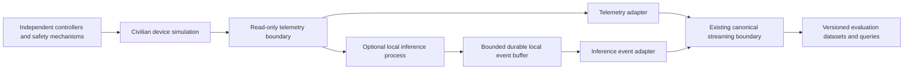

# Optional Edge AI research extension

## Status and purpose

This document reserves extension boundaries for a possible Version 2. No model, framework, simulator, inference service or AI infrastructure has been selected. Version 1 must provide a complete local streaming and analytics project independently.

The potential research question is whether a small model running near a simulated civilian device can improve a measurable task under limited compute and intermittent connectivity. Candidate tasks include sensor-quality assessment, equipment diagnostics, anomaly detection and offline processing. A model must be compared with a simple non-model baseline and an explicit evaluation dataset.

## Proposed separation of responsibilities

The arrows show data collection, not commands back to the controller. Inference processes must not alter safety thresholds, disable failsafes, or enter low-level flight control. Language models remain outside safety-critical control. The research scope excludes military targeting, electronic-warfare countermeasures and autonomous combat capabilities.

The data platform records observations and evaluation results. The simulator owns device behavior and independent safety mechanisms. The inference process owns its resource budget and task-specific outputs. Separate processes and credentials should prevent a failed experiment from requiring changes to the streaming core or controller.

## Future contracts

New event types will use the existing identity, provenance, time and compatibility principles. Define their contracts through a separate review; do not add required inference fields to Version 1 telemetry.

| Proposed information | Purpose |
| --- | --- |
| Experiment and simulation run IDs, scenario version and random seed | Reconstruct the experimental conditions |
| Device/session ID and monotonic local sequence | Distinguish offline observations and survive reconnects |
| Model artifact checksum, model version and runtime / preprocessing versions | Identify what actually produced an inference |
| Input event IDs, input interval and feature-contract version | Trace output to the exact source measurements |
| Inference ID, local start/end times and clock mapping quality | Identify an execution and interpret timing without assuming perfect UTC |
| Task/output schema, prediction and optional calibrated uncertainty | Give outputs a defined meaning; do not assume every model has meaningful confidence |
| CPU, memory, optional accelerator use and energy estimate method | Compare cost on the device; energy claims require a measurement method |
| Buffer occupancy, dropped-event counters and synchronization status | Expose disconnected operation and overflow |

A retry uploads the same inference event. A deliberate rerun is a distinct execution linked to the same evaluation input. The experiment manifest pins the distinction. Do not derive inference identity from upload time or assume a model artifact label is immutable without a checksum.

## Connectivity and event synchronization

The simulation may use a bounded durable local append buffer. Records retain measurement / inference time, session and local sequence across reconnects; admission time reflects later upload. Define capacity, overflow policy, retention and acknowledgements before testing offline behavior. Overflow must be visible in counters and manifests rather than disappearing behind a successful reconnect.

Track clock offset, anchor quality and resets. Avoid asserting a total order across devices with incomparable clocks. Uploading old events must use an isolated experiment run or a declared late / backfill path; it must not silently revise online Version 1 windows.

Disconnect/reconnect, repeated uploads, buffer exhaustion and clock reset are experiments with expected identity counts and outcomes. Use the existing archive and reconciliation boundaries to detect loss, without introducing a new message broker just for inference.

## Evaluation design

Before selecting a model, define the task, labels and baseline. Partition evaluation data by device, flight/session and time where appropriate to prevent near-duplicate measurements leaking between training and evaluation. Keep a held-out scenario set; record label provenance and uncertainty.

Compare versions on the same approved input manifests and simulator settings. Report task quality alongside latency distributions, device memory/CPU use, connectivity behavior and failure counts. For anomaly detection, specify the event-level definition, precision/recall and false alarms per operating interval; for sensor assessment, specify a labeled corruption family and severity. Do not treat an attractive demo or fluent explanation as evaluation evidence.

Experiments record artifact hashes, dependencies, configuration, random seeds and hardware. Some model runtimes may remain nondeterministic; disclose observed variation and repeated-run results rather than promising bitwise reproduction. Release results only with provenance and privacy approval for the evaluation data.

## Admission gate and non-goals

Version 2 starts only after the local Version 1 release, with an explicit research objective, contract proposal, safety-isolation description, resource budget, baseline and measurable acceptance criteria. Reuse canonical envelopes, archive, queries and metrics where they fit. Select a registry or orchestration service only if a concrete experiment demonstrates the need.

This foundation does not choose a model, create inference code, introduce AI-specific services, provision accelerators, implement SITL, or make flight-control changes. A future extension must remain removable without breaking telemetry ingestion or analytical correctness.
